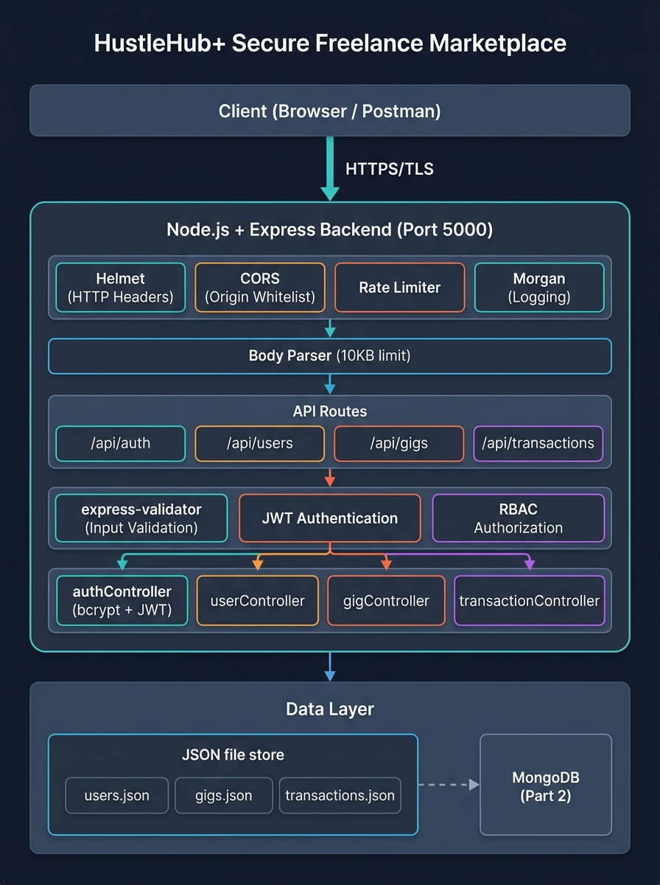
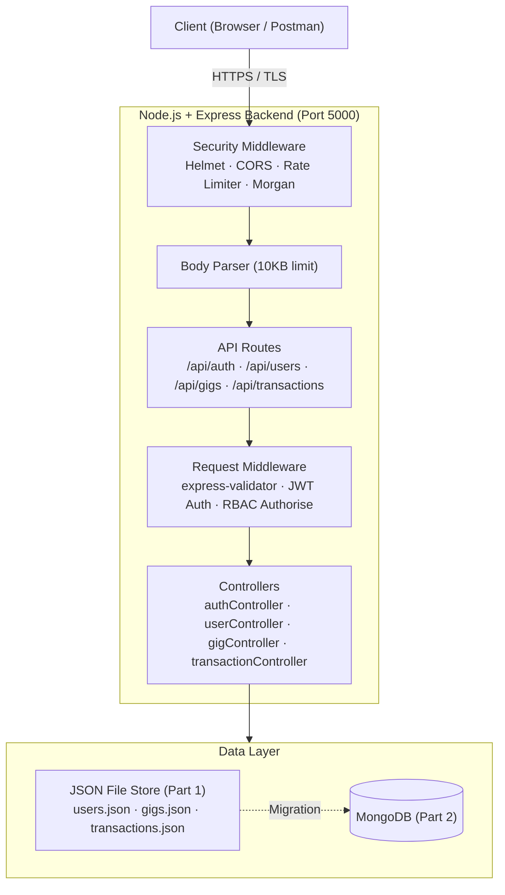

# HustleHub+ – Secure Freelance Marketplace

> **INSY7314 POE – Part 1: Secure Backend Foundations**

HustleHub+ is a secure freelance marketplace platform that allows freelancers to advertise services and clients to browse and book those services. This repository contains the backend API built for Part 1, establishing the secure foundational layer of the MERN-stack system.

---

## Table of Contents

1. [System Overview](#system-overview)
2. [Intended Users](#intended-users)
3. [Architecture Diagram](#architecture-diagram)
4. [Backend Structure](#backend-structure)
5. [Input Validation & Error Handling](#input-validation--error-handling)
6. [API Endpoints](#api-endpoints)
7. [Security Decisions](#security-decisions)
   - [Password Hashing](#password-hashing)
   - [JWT Authentication](#jwt-token-based-authentication)
   - [Input Validation & Sanitisation](#input-validation--sanitisation)
   - [HTTPS Configuration](#https-configuration)
   - [Additional Security Controls](#additional-security-controls)
8. [Getting Started](#getting-started)
9. [Running the API](#running-the-api)
10. [Running Tests](#running-tests)
11. [Postman Collection](#postman-collection)
12. [What's Left for Part 2](#whats-left-for-part-2)

---

## System Overview

**HustleHub+** is a secure freelance marketplace platform that connects freelancers offering professional services with clients who need to hire them. The platform allows freelancers to advertise their skills through service listings ("gigs"), while clients can browse, search, and book those services with simulated payments.

### Purpose

The South African freelance economy is growing rapidly, yet many platforms lack adequate security measures to protect user data and financial information. HustleHub+ was designed to address this gap by building security into the foundation of the system from day one — not as an afterthought.

### Key Goals

- **Secure authentication** — Passwords are hashed with bcrypt; sessions are managed via short-lived JWTs
- **Role-based access control** — Clients, freelancers, and admins each have distinct permissions enforced at the middleware level
- **Data protection** — All traffic is encrypted over HTTPS; sensitive fields are never exposed in API responses or logs
- **Input safety** — Every user input is validated and sanitised before reaching business logic, preventing injection and XSS attacks

### Technology Stack (MERN)

The platform is designed and implemented following the **MERN architecture**:

| Layer      | Technology               | Status     |
|------------|--------------------------|------------|
| MongoDB    | Database (document store)| Part 2     |
| Express    | Backend REST API         | ✅ Part 1  |
| React      | Frontend SPA             | Part 2     |
| Node.js    | Server runtime           | ✅ Part 1  |

The platform processes sensitive information including user credentials, transactional records, and income-related data. Security is treated as a **primary design concern**, not an afterthought.

---

## Intended Users

HustleHub+ supports three user roles, each with distinct capabilities and access levels enforced through role-based access control (RBAC):

| Role           | Description                                                                 | Key Permissions |
|----------------|-----------------------------------------------------------------------------|----------------|
| **Freelancer** | Registers on the platform, creates and manages service listings (gigs), receives bookings and payments, views income and tax dashboard. | Create/update/delete own gigs, view income summary |
| **Client**     | Registers on the platform, browses and searches freelancer gigs, places bookings, makes simulated payments. | Browse gigs, book services, make payments |
| **Admin**      | Platform administrator. Can view all users and manage platform content.     | View all users, delete any gig, view all transactions |

Access control is enforced at two levels:
1. **Authentication** (`authenticate` middleware) — Verifies the JWT token is valid; rejects unauthenticated requests with HTTP 401
2. **Authorisation** (`authorise(...roles)` middleware) — Checks the user's role against the permitted roles for each endpoint; rejects unauthorised requests with HTTP 403

---

## Architecture Diagram

The following diagram illustrates the full request flow through the HustleHub+ backend, including security boundaries at each layer:



### Security Boundaries

The architecture enforces security at every layer of the request lifecycle:

| Boundary | Layer | Protection |
|----------|-------|------------|
| **Transport** | HTTPS/TLS | All data encrypted in transit; HTTP is never exposed |
| **Perimeter** | Helmet, CORS, Rate Limiter | Security headers set, origins whitelisted, brute-force mitigated |
| **Input** | express-validator, Body Parser (10KB) | All input validated/sanitised before reaching controllers; oversized payloads rejected |
| **Identity** | JWT Authentication | Token verified on every protected request; expired/tampered tokens rejected (401) |
| **Access** | RBAC Authorisation | Role checked against endpoint permissions; unauthorised roles rejected (403) |
| **Output** | Secure Error Handler | Stack traces, file paths, and internal details never sent to client |
| **Data** | bcrypt, `omitPassword()` | Passwords hashed before storage; password hashes stripped from all API responses |

### Mermaid Diagram



---

## Backend Structure

The backend follows a clear **separation of concerns** pattern, dividing code into distinct layers:

| Layer | Purpose | Files |
|-------|---------|-------|
| **Routes** | Define API endpoints and attach validation chains + middleware | `authRoutes.js`, `userRoutes.js`, `gigRoutes.js`, `transactionRoutes.js` |
| **Middleware** | Cross-cutting concerns (auth, validation, error handling, rate limiting) | `auth.js`, `validate.js`, `errorHandler.js`, `rateLimiter.js` |
| **Controllers** | Business logic — process validated requests and return responses | `authController.js`, `userController.js`, `gigController.js`, `transactionController.js` |
| **Data / Store** | Persistence layer — read/write to JSON file stores (MongoDB in Part 2) | `userStore.js`, `gigStore.js`, `transactionStore.js` |
| **Config** | Application constants and configuration values | `constants.js` |

This separation ensures that each layer has a single responsibility: routes handle HTTP routing, middleware handles cross-cutting security concerns, controllers handle business logic, and stores handle data persistence. This makes the codebase easier to test, maintain, and extend.

### Folder Tree

```
backend/
├── server.js                        # HTTPS server entry point
├── generate-certs.js                # Self-signed SSL certificate generator
├── package.json
├── .env.example                     # Environment variable template
├── .gitignore
│
├── ssl/                             # SSL certs (git-ignored)
│   ├── server.key
│   └── server.cert
│
├── logs/                            # Application logs (git-ignored)
│   └── app.log
│
└── src/
    ├── app.js                       # Express app setup (middleware stack, route mounting)
    │
    ├── config/
    │   └── constants.js             # App-wide constants (roles, JWT config)
    │
    ├── controllers/
    │   ├── authController.js        # register(), login() – bcrypt hashing + JWT signing
    │   ├── userController.js        # getProfile(), getAllUsers()
    │   ├── gigController.js         # listGigs(), getGig(), createGig(), updateGig(), deleteGig()
    │   └── transactionController.js # createTransaction(), getIncome(), getAllTransactions()
    │
    ├── middleware/
    │   ├── auth.js                  # authenticate() – JWT verification
    │   │                            # authorise(...roles) – RBAC enforcement
    │   ├── errorHandler.js          # Global error handler (no stack trace leakage)
    │   ├── rateLimiter.js           # General (100/15min) + auth-specific (20/15min) rate limiting
    │   └── validate.js              # express-validator result handler → 422 responses
    │
    ├── routes/
    │   ├── authRoutes.js            # POST /api/auth/register, /api/auth/login
    │   ├── userRoutes.js            # GET  /api/users/profile, /api/users
    │   ├── gigRoutes.js             # CRUD /api/gigs
    │   └── transactionRoutes.js     # POST /api/transactions, GET /api/transactions/income
    │
    ├── utils/
    │   ├── logger.js                # Structured logger (console + file, no passwords logged)
    │   ├── userStore.js             # File-based user persistence
    │   ├── gigStore.js              # File-based gig persistence
    │   └── transactionStore.js      # File-based transaction persistence
    │
    └── data/
        ├── users.json               # User store (git-tracked as empty [])
        ├── gigs.json                # Gig store  (git-tracked as empty [])
        └── transactions.json        # Transaction store (git-tracked as empty [])

tests/
└── auth.test.js                     # Jest + Supertest integration tests
```

### Request Lifecycle

Every API request flows through the following pipeline:

```
Client Request
  → Helmet (security headers)
  → CORS (origin check)
  → Rate Limiter (brute-force protection)
  → Body Parser (JSON, 10KB limit)
  → Route matched
    → express-validator (input validation/sanitisation)
    → validate middleware (reject 422 if invalid)
    → authenticate (JWT token verification, if protected route)
    → authorise (role check, if role-restricted route)
    → Controller (business logic)
      → Store (data read/write)
  → Response sent
  → errorHandler (catches any unhandled errors — no stack traces leaked)
```

---

## Input Validation & Error Handling

### Input Validation

All user-supplied input is validated and sanitised **before** reaching any controller or business logic. This is implemented using the `express-validator` library, with validation chains defined directly in the route files.

**How it works:**

1. **Validation chains** in route files (e.g., `authRoutes.js`) define the rules for each field
2. The **`validate` middleware** (`src/middleware/validate.js`) checks the results
3. If validation fails → HTTP **422 Unprocessable Entity** with a structured `fields` array
4. If validation passes → request continues to the controller

**Registration validation rules:**

| Field    | Validation Rules | Sanitisation |
|----------|------------------|--------------|
| `name`   | Required, 2–80 characters | Trimmed, HTML-escaped (`.escape()`) |
| `email`  | Required, valid email format | Trimmed, normalised to lowercase |
| `password` | Required, ≥8 chars, must contain uppercase, lowercase, number, and special character | None (hashed by bcrypt immediately) |
| `role`   | Optional, must be `"client"` or `"freelancer"` | Trimmed |

**What this prevents:**

| Attack | How it's prevented |
|--------|--------------------|
| **SQL/NoSQL injection** | Sanitisation strips dangerous characters before they reach the data layer |
| **Cross-site scripting (XSS)** | `.escape()` HTML-encodes special characters like `<`, `>`, `&` in string fields |
| **bcrypt denial-of-service** | Password length capped at 128 characters (bcrypt has a 72-byte input limit; extremely long inputs without a cap could exhaust CPU) |
| **Logic errors** | Type checking and length constraints prevent unexpected data from causing failures |

**Example validation error response (422):**
```json
{
  "error": "Validation failed.",
  "fields": [
    { "field": "password", "message": "Password must be at least 8 characters." },
    { "field": "password", "message": "Password must contain at least one uppercase letter." },
    { "field": "password", "message": "Password must contain at least one number." },
    { "field": "password", "message": "Password must contain at least one special character." }
  ]
}
```

### Error Handling

The global error handler (`src/middleware/errorHandler.js`) is the **last line of defence** against accidental information disclosure. It ensures that internal system details are **never** leaked to the client.

**What the error handler strips from responses:**

| Information | Leaked? | Why |
|-------------|---------|-----|
| Stack traces | ❌ Never | Reveals file paths, line numbers, and internal function names to attackers |
| File system paths | ❌ Never | Exposes server directory structure |
| Internal error messages | ⚠️ Dev only | Shown only when `NODE_ENV=development`; hidden in production |
| Detailed error objects | ❌ Never | Only a generic message is sent to the client |

**How it works:**

- **Client errors (4xx):** The error's own message is returned (e.g., "Invalid email or password")
- **Server errors (5xx) in production:** A generic `"Internal server error. Please try again later."` is returned
- **Server errors (5xx) in development:** The error message is returned with a `hint: "Check server logs for details."`
- **All errors:** Full error details (including stack trace) are logged server-side to `logs/app.log` for debugging

```javascript
// From errorHandler.js — client never sees the stack trace
const response = {
  error: statusCode < 500
    ? (err.message || 'Request error.')
    : (isDev ? err.message : 'Internal server error. Please try again later.'),
};
```

---

## API Endpoints

### Public Endpoints

| Method | Endpoint              | Description                          |
|--------|-----------------------|--------------------------------------|
| GET    | `/api/health`         | Health check                         |
| POST   | `/api/auth/register`  | Register new user (client/freelancer)|
| POST   | `/api/auth/login`     | Authenticate and receive JWT         |

### Protected Endpoints (require `Authorization: Bearer <token>`)

| Method | Endpoint                    | Role Required              | Description                             |
|--------|-----------------------------|----------------------------|-----------------------------------------|
| GET    | `/api/users/profile`        | Any authenticated          | Get own user profile                    |
| GET    | `/api/users`                | Admin only                 | List all users                          |
| GET    | `/api/gigs`                 | Any authenticated          | Browse all gigs                         |
| GET    | `/api/gigs/:id`             | Any authenticated          | Get single gig                          |
| POST   | `/api/gigs`                 | Freelancer only            | Create a new gig                        |
| PUT    | `/api/gigs/:id`             | Freelancer (owner)         | Update own gig                          |
| DELETE | `/api/gigs/:id`             | Freelancer (owner) or Admin| Delete a gig                            |
| POST   | `/api/transactions`         | Client only                | Book a gig (simulated payment)          |
| GET    | `/api/transactions/income`  | Freelancer only            | View income summary + estimated tax     |
| GET    | `/api/transactions`         | Admin only                 | View all platform transactions          |

### Request / Response Examples

**Register (POST /api/auth/register)**
```json
// Request body
{
  "name": "Alice Dlamini",
  "email": "alice@example.com",
  "password": "SecurePass1!",
  "role": "client"
}

// 201 Created response
{
  "message": "Registration successful.",
  "token": "eyJhbGciOiJIUzI1NiIsInR5cCI6IkpXVCJ9...",
  "user": {
    "id": "550e8400-e29b-41d4-a716-446655440000",
    "name": "Alice Dlamini",
    "email": "alice@example.com",
    "role": "client",
    "createdAt": "2026-08-04T11:00:00.000Z"
  }
}
```

**Login (POST /api/auth/login)**
```json
// Request body
{ "email": "alice@example.com", "password": "SecurePass1!" }

// 200 OK response
{
  "message": "Login successful.",
  "token": "eyJhbGciOiJIUzI1NiIsInR5cCI6IkpXVCJ9...",
  "user": { "id": "...", "name": "Alice Dlamini", "email": "alice@example.com", "role": "client" }
}
```

**Validation Error (422)**
```json
{
  "error": "Validation failed.",
  "fields": [
    { "field": "password", "message": "Password must contain at least one special character." },
    { "field": "email",    "message": "A valid email address is required." }
  ]
}
```

---

## Security Decisions

### Password Hashing

**Algorithm used: bcrypt (via `bcryptjs`)**

Passwords are **never stored in plain text** at any stage. When a user registers, their password is immediately hashed using `bcrypt.hash()` before being written to the data store. The salt rounds are configurable via the `BCRYPT_SALT_ROUNDS` environment variable (default: 12).

**Why bcrypt?**
- bcrypt is a password-specific hashing algorithm designed to be intentionally slow, making brute-force and rainbow table attacks computationally expensive.
- Each hash includes a unique random salt, meaning two users with the same password will have different hashes.
- bcrypt's work factor can be increased over time to keep pace with faster hardware without requiring users to reset passwords.
- Unlike SHA-256/MD5 (which are fast general-purpose hashes), bcrypt is purpose-built for password storage.

**Implementation details:**
- Salt rounds: **12** (recommended minimum; produces ~300ms hash time on modern hardware, making automated attacks impractical)
- Hash is stored as a 60-character string in the `passwordHash` field
- The field is **stripped from all API responses** using the `omitPassword()` helper before any user object is sent to the client
- Passwords are **never logged** — only user IDs and roles appear in log files

**Timing attack prevention:**
Even when a user is not found, the login controller runs a bcrypt comparison against a dummy hash. This ensures the response time is consistent whether or not the email exists, preventing attackers from using response timing to enumerate valid accounts.

```javascript
// From authController.js
const DUMMY_HASH = '$2b$12$invalidhashfortimingnormalizationpurposesonly';
const hashToCompare = user ? user.passwordHash : DUMMY_HASH;
const isMatch = await bcrypt.compare(password, hashToCompare);
```

---

### JWT Token-Based Authentication

**Library: `jsonwebtoken` | Algorithm: HS256**

After successful registration or login, the server issues a **JSON Web Token (JWT)** that the client must include in the `Authorization: Bearer <token>` header on all protected requests.

**Token payload (claims):**
```json
{
  "id":    "user-uuid",
  "email": "user@example.com",
  "role":  "client",
  "iat":   1722768000,
  "exp":   1722771600,
  "iss":   "hustlehub-api",
  "aud":   "hustlehub-client"
}
```

Only **minimal claims** are embedded — no sensitive data such as the password hash, phone number, or address is ever placed inside the token payload.

**Why JWT?**
- JWTs are stateless: the server does not need to store session data, making the architecture horizontally scalable.
- Tokens carry role information, enabling the server to enforce role-based access control on every request without a database lookup.
- Short expiry times (default 1 hour) limit the window of risk if a token is stolen.

**Security measures:**
| Measure | Detail |
|---------|--------|
| Algorithm pinning | `algorithms: ['HS256']` specified on `jwt.verify()` — prevents the "alg:none" attack where an attacker sets the algorithm to none in a crafted token |
| Secret strength | `JWT_SECRET` loaded from environment (never hardcoded). Must be at minimum 64 random characters |
| Short expiry | Default 1 hour; configurable via `JWT_EXPIRES_IN` |
| Issuer + Audience | `iss: 'hustlehub-api'` and `aud: 'hustlehub-client'` prevent token reuse across services |
| Error messages | Expired vs invalid tokens return clear but non-revealing messages |

**How JWT protects routes:**
The `authenticate` middleware in `src/middleware/auth.js` verifies the token on every protected request. If verification fails (expired, tampered, missing), the request is rejected with HTTP 401 before reaching the controller.

The `authorise(...roles)` factory then checks that the authenticated user's role is in the permitted set, returning HTTP 403 if not.

---

### Input Validation & Sanitisation

**Library: `express-validator`**

All user-supplied input is validated and sanitised **before** reaching any controller or business logic. This prevents:
- SQL/NoSQL injection (sanitisation strips dangerous characters)
- XSS attacks (`.escape()` HTML-encodes special characters)
- Logic errors from unexpected data types or lengths
- bcrypt DoS (password length capped at 128 chars — bcrypt has a 72-byte input limit, and extremely long inputs without a cap could be used to exhaust CPU)

**Registration validation rules:**
| Field    | Rules |
|----------|-------|
| name     | Required, 2–80 chars, HTML-escaped |
| email    | Required, valid email format, normalised (lowercase) |
| password | Required, ≥8 chars, must contain uppercase, lowercase, number, and special character |
| role     | Optional, must be `"client"` or `"freelancer"` |

**Password strength policy rationale:**
A minimum of 8 characters with mixed character requirements significantly increases the search space for brute-force attacks. A password meeting these requirements has at least 94^8 ≈ 6 quadrillion possible values (using printable ASCII), making offline attacks impractical.

**Validation error responses:**
Failed validation returns HTTP **422 Unprocessable Entity** with a structured `fields` array. Internal details (file paths, schema names, stack traces) are never included.

---

### HTTPS Configuration

The API is served **exclusively over HTTPS** using a self-signed SSL/TLS certificate. HTTP is not exposed.

**Why HTTPS?**
- All data transmitted between client and server — including JWTs, passwords, and personal information — is encrypted in transit.
- Without HTTPS, a network attacker performing a man-in-the-middle (MITM) attack could intercept login credentials or steal JWT tokens.
- HTTPS also enables the `Secure` flag on cookies (used in Part 2 for httpOnly cookie-based token storage).
- Modern browsers display security warnings for non-HTTPS sites, reducing user trust.

**Implementation:**
- `server.js` loads SSL key and certificate files and creates an `https.createServer()` instance.
- SSL files are generated locally using OpenSSL via `node generate-certs.js`.
- Certificates are **git-ignored** — each developer generates their own locally.
- The `Strict-Transport-Security` (HSTS) header is set via Helmet with `maxAge: 31536000` (1 year), instructing browsers to always use HTTPS.

**For production:** A certificate from a trusted Certificate Authority (CA) such as Let's Encrypt should replace the self-signed certificate. The self-signed certificate is for local development only.

---

### Additional Security Controls

#### Helmet (HTTP Security Headers)
`helmet` automatically sets the following HTTP response headers:

| Header | Purpose |
|--------|---------|
| `Content-Security-Policy` | Restricts sources of scripts/styles/images to prevent XSS |
| `Strict-Transport-Security` | Forces HTTPS for 1 year |
| `X-Content-Type-Options: nosniff` | Prevents MIME type sniffing |
| `X-Frame-Options: DENY` | Prevents clickjacking |
| `X-XSS-Protection` | Enables browser XSS filter |
| `Referrer-Policy` | Controls referrer information leakage |

#### CORS (Cross-Origin Resource Sharing)
Only requests from the configured `CORS_ORIGIN` (default: `https://localhost:3000`) are accepted. All other origins receive a CORS error. This prevents malicious websites from making authenticated API requests using a victim's stored credentials.

#### Rate Limiting
- **General API**: 100 requests per 15 minutes per IP
- **Auth routes** (`/api/auth/*`): Stricter — 20 requests per 15 minutes per IP

This mitigates credential-stuffing and brute-force login attacks.

#### Secure Error Handling
The global error handler (`src/middleware/errorHandler.js`) ensures that:
- Stack traces are **never** sent to the client
- File system paths are **never** exposed
- Internal error messages are only shown in development mode
- All errors are logged server-side with full details for debugging

#### Request Body Size Limit
JSON request bodies are limited to **10KB** to prevent large payload denial-of-service attacks:
```javascript
app.use(express.json({ limit: '10kb' }));
```

#### Structured Logging
All key system events (registrations, logins, failed auth attempts, forbidden access) are logged to both console and `logs/app.log` with timestamps. Logs never contain passwords or full token values. This supports security auditing and incident response.

---

## Getting Started

### Prerequisites
- Node.js ≥ 18
- npm ≥ 9
- OpenSSL (for generating SSL certificates)
  - Windows: Install via [Win32 OpenSSL](https://slproweb.com/products/Win32OpenSSL.html) or `choco install openssl`
  - macOS: `brew install openssl`
  - Linux: `sudo apt install openssl`

### Installation

```bash
# 1. Clone the repository
git clone https://github.com/ST10445928/INSY7314.git
cd INSY7314/backend

# 2. Install dependencies
npm install

# 3. Set up environment variables
cp .env.example .env
# Edit .env and set JWT_SECRET to a long random string (min 64 chars)
# You can generate one with: node -e "console.log(require('crypto').randomBytes(64).toString('hex'))"

# 4. Generate SSL certificate
node generate-certs.js
```

### Environment Variables

Copy `.env.example` to `.env` and configure:

```env
PORT=5000
NODE_ENV=development
JWT_SECRET=<your-long-random-secret>
JWT_EXPIRES_IN=1h
SSL_KEY_PATH=./ssl/server.key
SSL_CERT_PATH=./ssl/server.cert
CORS_ORIGIN=https://localhost:3000
BCRYPT_SALT_ROUNDS=12
```

> ⚠️ **Never commit your `.env` file.** It is listed in `.gitignore`.

---

## Running the API

```bash
# Start in development mode (with auto-restart on changes)
npm run dev

# Start in production mode
npm start
```

The API will be available at `https://localhost:5000`.

> **Note:** Because the certificate is self-signed, Postman will show an SSL warning. In Postman settings, disable "SSL certificate verification" for local testing.

---

## Running Tests

```bash
# Run all tests
npm test

# Run with coverage report
npm test -- --coverage

# Watch mode (re-runs on file changes)
npm run test:watch
```

Tests are located in `tests/auth.test.js` and use **Jest** + **Supertest**. They reset the user store before each test to ensure isolation.

---

## Postman Collection

The file `hustlehub_api.postman_collection.json` (in the repo root) contains a complete Postman collection with:
- All endpoints with example request bodies
- Automated test scripts that validate status codes and response shapes
- Auto-capture of JWT token from login/register responses into the `{{token}}` collection variable

**To use:**
1. Open Postman → Import → select `hustlehub_api.postman_collection.json`
2. In Postman Settings → turn off SSL certificate verification
3. Run "Register – Valid Client" first, then run other requests
4. Use "Run Collection" to execute all tests automatically

---

## What's Left for Part 2

| Item | Description |
|------|-------------|
| MongoDB integration | Replace JSON file store with Mongoose + MongoDB |
| React frontend | Full SPA with login, registration, gig browsing, dashboard |
| Booking system | Client books a gig → transaction record created |
| Income tracking | Freelancer dashboard showing earnings |
| Tax calculation | Estimated tax obligations display |
| Dockerisation | Containerise backend + frontend |
| CI/CD pipeline | GitHub Actions with automated tests and security scans |
| Architecture diagram | MERN system diagram (to be drawn by team member) |
| Demo video | Screen recording of API in action |
| Postman screenshots | Screenshots of all API responses |
