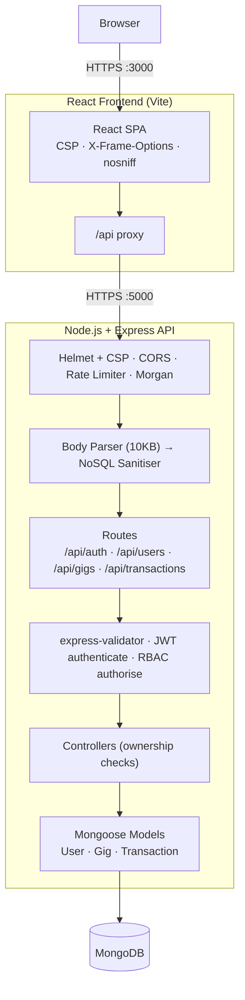

# HustleHub+ – Secure Freelance Marketplace

> **INSY7314 POE – Part 2: Secure Stack**

HustleHub+ is a secure, full-stack MERN marketplace. Freelancers list their services ("gigs"). Clients browse those gigs and book them with a simulated payment. Every booking creates a transaction record that tracks the freelancer's income.

Part 1 built the secure backend foundations. Part 2 extends them into a full-stack application:

- **MongoDB** replaces the JSON file store (Mongoose models).
- A **React frontend** handles registration, login, browsing, gig management, booking and booking history.
- **Gig management** is complete, with ownership enforcement (create, view, update, delete).
- **Bookings and transactions** are linked to both the client and the freelancer, and income is tracked.
- **Security** is applied end to end. It includes RBAC, input validation and sanitisation, NoSQL-injection protection, rate limiting on auth and booking, and Helmet with a strict CSP on the API and the frontend.
- **Testing** covers the backend (Jest), the frontend (Vitest and React Testing Library) and the API (Postman, executed with Newman).

---

## Table of Contents

1. [Application Features](#application-features)
2. [Architecture](#architecture)
3. [Project Structure](#project-structure)
4. [Roles & Access Control (RBAC)](#roles--access-control-rbac)
5. [API Endpoints](#api-endpoints)
6. [Security Measures](#security-measures)
7. [Getting Started](#getting-started)
8. [Running the Backend](#running-the-backend)
9. [Running the Frontend](#running-the-frontend)
10. [Testing Procedures](#testing-procedures)
11. [Application Screenshots](#application-screenshots)
12. [Demonstration Video](#demonstration-video)
13. [Part 1 Evidence](#part-1-evidence)

---

## Application Features

### All users
- **Register** as a client or a freelancer. Admin accounts cannot be self-registered.
- **Log in** to receive a short-lived JWT (1 hour). The session is cleared when the browser tab closes or the token expires.
- **Validation as you type.** Errors appear inline on the form, and server errors are shown as friendly messages.

### Clients
- **Browse** every gig listed on the marketplace.
- **Book a gig.** A confirmation step shows the gig and its price, and payment is simulated with no real money involved. Each booking creates a `completed` transaction.
- **My bookings** lists every booking the client has made, with the freelancer, the amount and the date.

### Freelancers
- **My gigs** lets a freelancer create, edit and delete their own listings. They cannot edit or delete anyone else's.
- **Bookings & income** lists bookings clients made for the freelancer's gigs. It also shows total income, the number of bookings and an estimated tax figure (flat 25% placeholder).

### Admins
- **Admin dashboard** lists all users and all platform transactions, with total booking volume.
- **Moderation:** an admin can remove any gig from the marketplace.

---

## Architecture




**Request lifecycle (API):**

```
Request → Helmet (headers + CSP) → CORS (origin allow-list) → Rate limiter
  → JSON body (10KB max) → NoSQL sanitiser (strips $ / . keys)
  → Route → [booking limiter] → authenticate (JWT) → authorise (role)
  → express-validator (validate + escape) → validate (422 on failure)
  → Controller (ownership checks) → Mongoose → MongoDB
  → Response / errorHandler (no stack traces or internals leaked)
```

---

## Project Structure

```
INSY7314/
├── backend/                         # Express API
│   ├── server.js                    # HTTPS entry point – connects to MongoDB, then listens
│   ├── generate-certs.js            # Self-signed SSL certificate generator
│   ├── scripts/
│   │   ├── local-db.js              # npm run db:local – local MongoDB without installing it
│   │   ├── create-admin.js          # npm run create-admin – provisions the admin account
│   │   └── run-newman.js            # npm run test:api – runs the Postman collection with Newman
│   ├── src/
│   │   ├── app.js                   # Middleware stack and route mounting
│   │   ├── config/                  # constants.js (roles, JWT, password policy), db.js (Mongoose)
│   │   ├── models/                  # User, Gig, Transaction (+ safe toJSON transform)
│   │   ├── controllers/             # auth, user, gig, transaction
│   │   ├── middleware/              # auth (JWT + RBAC), validate, sanitize, rateLimiter, errorHandler
│   │   ├── routes/                  # Route definitions + validation chains
│   │   └── utils/logger.js          # Console + file logger (no secrets logged)
│   └── tests/                       # Jest + Supertest (in-memory MongoDB)
│
├── frontend/                        # React SPA (Vite)
│   ├── vite.config.js               # HTTPS dev server, /api proxy, CSP + security headers
│   ├── src/
│   │   ├── api/                     # fetch wrapper (safe error handling) + endpoint functions
│   │   ├── auth/AuthContext.jsx     # Session (JWT + user) in sessionStorage, auto-logout on 401
│   │   ├── components/              # NavBar, ProtectedRoute, GigCard, GigForm, FormField, Alert
│   │   ├── pages/                   # Login, Register, Gigs, MyGigs, Bookings, Admin
│   │   ├── utils/                   # Client-side validation, display formatting
│   │   └── test/                    # Vitest + React Testing Library tests
│   └── test-results/                # Frontend test evidence
│
├── hustlehub_api.postman_collection.json   # Postman collection (50 requests)
├── postman/
│   ├── hustlehub-local.postman_environment.json
│   └── newman-results/              # Newman execution evidence
└── images/                          # Screenshots
```

---

## Roles & Access Control (RBAC)

Access control is enforced on the server at three levels:

1. **Authentication.** The `authenticate` middleware verifies the JWT's signature, expiry, algorithm, issuer and audience. If any check fails, the request gets **401**.
2. **Authorisation.** `authorise(...roles)` checks the user's role against the roles allowed for the endpoint. A mismatch gets **403**.
3. **Ownership.** Controllers compare the resource's owner with the token's user id. For example, `gig.freelancer` must equal `req.user.id`, otherwise the request gets **403**. Every booking and income query is filtered by the logged-in user's id, so users only ever see their own records.

| Capability | Client | Freelancer | Admin |
|---|:---:|:---:|:---:|
| Browse / view gigs | ✅ | ✅ | ✅ |
| Create gig | ❌ | ✅ | ❌ |
| Update gig | ❌ | ✅ own only | ❌ |
| Delete gig | ❌ | ✅ own only | ✅ any |
| Book gig (create transaction) | ✅ | ❌ | ❌ |
| View own bookings | ✅ made | ✅ received | ❌ |
| View income & estimated tax | ❌ | ✅ own only | ❌ |
| List all users | ❌ | ❌ | ✅ |
| List all transactions | ❌ | ❌ | ✅ |

The frontend mirrors these rules, using `ProtectedRoute` and showing only the buttons each role can use. That is purely for usability: the API enforces every rule independently.

---

## API Endpoints

| Method | Endpoint | Access | Description |
|---|---|---|---|
| GET | `/api/health` | Public | Health check |
| POST | `/api/auth/register` | Public (rate limited) | Register a client or freelancer |
| POST | `/api/auth/login` | Public (rate limited) | Log in, receive JWT |
| GET | `/api/users/profile` | Any authenticated | Own profile |
| GET | `/api/users` | Admin | All users |
| GET | `/api/gigs` | Any authenticated | All gigs (freelancer name included) |
| GET | `/api/gigs/mine` | Freelancer | Own gigs |
| GET | `/api/gigs/:id` | Any authenticated | Single gig |
| POST | `/api/gigs` | Freelancer | Create gig |
| PUT | `/api/gigs/:id` | Freelancer (owner) | Update gig (partial) |
| DELETE | `/api/gigs/:id` | Freelancer (owner) or Admin | Delete gig |
| POST | `/api/transactions` | Client (rate limited) | Book a gig (simulated payment) → transaction |
| GET | `/api/transactions/mine` | Client / Freelancer | Bookings made (client) or received (freelancer) |
| GET | `/api/transactions/income` | Freelancer | Income summary + estimated tax |
| GET | `/api/transactions` | Admin | All transactions |

**Book a gig:** `POST /api/transactions` with body `{ "gigId": "<id>" }`

```json
{
  "message": "Booking confirmed. Payment simulated successfully.",
  "transaction": {
    "id": "6acbec8bc1a6ce68606f3ca1",
    "gig": "6acbec8ac1a6ce68606f3c9b",
    "client": "6acbec89c1a6ce68606f3c93",
    "freelancer": "6acbec88c1a6ce68606f3c8d",
    "gigTitle": "Premium Logo Design",
    "amount": 1800,
    "status": "completed",
    "createdAt": "2026-10-11T20:08:03.211Z"
  }
}
```

The `amount` is always taken from the stored gig, never from the request body, so a client cannot choose their own price. The gig title and amount are also copied onto the transaction, so the record stays accurate if the gig is later edited or deleted.

---

## Security Measures

### Summary

| Threat | Control | Where |
|---|---|---|
| Credential theft in transit (MITM) | HTTPS-only API (TLS, RSA 2048 / SHA-256) and HSTS (1 year). The frontend dev server and preview also run over HTTPS. | `server.js`, `app.js`, `vite.config.js` |
| Password cracking after a breach | bcrypt with cost 12. `passwordHash` is `select: false` and stripped by `toJSON`. | `authController.js`, `models/User.js` |
| User enumeration | Same error for unknown email and wrong password, plus timing normalisation with a **real** bcrypt dummy hash | `authController.js` |
| Token forgery / misuse | JWT pinned to HS256 and checked for **issuer and audience**, 1-hour expiry, secret loaded from env | `middleware/auth.js` |
| Privilege escalation | `authorise()` role checks, ownership checks in controllers, admin role cannot be self-registered | routes, controllers |
| Insecure direct object reference (IDOR) | Queries filtered by `req.user.id`, and ownership compared before any update or delete | `gigController.js`, `transactionController.js` |
| Mass assignment | Controllers copy only whitelisted fields, so `freelancer`, `role`, `amount` and `status` cannot be set by the client | controllers |
| NoSQL injection | Sanitiser strips `$` and `.` keys from body, query and params. `strictQuery` is on. Ids are validated with `isMongoId()`. | `middleware/sanitize.js`, `config/db.js` |
| Stored XSS | `express-validator` `.escape()` on all text input. React renders text, never HTML (no `dangerouslySetInnerHTML`). Strict CSP. | routes, frontend |
| Brute force / credential stuffing | Auth limiter: 20 requests per 15 minutes per IP | `middleware/rateLimiter.js` |
| Booking spam / transaction flooding | Booking limiter: 10 requests per 15 minutes per IP | `middleware/rateLimiter.js` |
| General abuse / DoS | 100 requests per 15 minutes on `/api/*`, 10KB body limit, 128-character password cap (prevents bcrypt DoS) | `app.js`, `authRoutes.js` |
| Clickjacking, MIME sniffing | Helmet: `frame-ancestors 'none'`, `X-Frame-Options`, `nosniff`. The frontend sends the same headers. | `app.js`, `vite.config.js` |
| Cross-origin abuse | CORS allow-list (`CORS_ORIGIN`). Unknown origins get **403**. | `app.js` |
| Information disclosure | Global error handler: no stack traces or internals. The frontend shows a generic message on 5xx errors. No source maps in the build. | `errorHandler.js`, `api/client.js`, `vite.config.js` |

### Validation & sanitisation

All input is validated with `express-validator` chains in the route files **before** it reaches a controller. Invalid input returns **422** with a `fields` array, which the frontend displays next to the matching form fields:

| Endpoint | Rules |
|---|---|
| Register | name 2–80 characters (escaped). Valid email (normalised). Password 8–128 characters with upper, lower, number and special characters. Role must be `client` or `freelancer`. |
| Login | Valid email. Password required, maximum 128 characters. |
| Create / update gig | Title 5–100 characters, description 10–2000, category up to 50 (all trimmed and escaped). Price 1–1,000,000. On update every field is optional, but any field sent is validated. |
| Book | `gigId` must be a valid MongoDB ObjectId |
| `:id` params | `isMongoId()` |

The frontend runs the same checks (`src/utils/validation.js`) for instant feedback, but the server never relies on them.

Text is stored HTML-escaped (for example, `<script>` is stored as `&lt;script&gt;`). The frontend decodes these entities for display (`decodeEntities`). This is safe because React inserts strings as text nodes: a payload is shown literally and never executed. The tests cover this case.

### Rate limiting

| Limiter | Applies to | Limit | Response when exceeded |
|---|---|---|---|
| General | `/api/*` | 100 requests per 15 minutes per IP (configurable via `RATE_LIMIT_*`) | `429 { "error": "Too many requests from this IP. Please try again later.", "retryAfterSeconds": 900 }` |
| Auth | `/api/auth/*` | 20 requests per 15 minutes per IP | `429 { "error": "Too many authentication attempts. Please try again in 15 minutes.", ... }` |
| Booking | `POST /api/transactions` | 10 requests per 15 minutes per IP | `429 { "error": "Too many booking attempts. Please try again in 15 minutes.", ... }` |

All limiters also send the standard `RateLimit-*` and `Retry-After` headers. The frontend displays the 429 message to the user.

### Security headers & Content Security Policy

**API (Helmet):**
```
Content-Security-Policy: default-src 'self'; script-src 'self'; style-src 'self'; img-src 'self' data:;
                         object-src 'none'; frame-ancestors 'none'; base-uri 'self'; form-action 'self'
Strict-Transport-Security: max-age=31536000; includeSubDomains; preload
X-Content-Type-Options: nosniff · X-Frame-Options: SAMEORIGIN · Referrer-Policy: no-referrer · (X-Powered-By removed)
```

**Frontend (production build via `npm run preview`):**
```
Content-Security-Policy: default-src 'self'; script-src 'self'; style-src 'self'; img-src 'self' data:; font-src 'self';
                         connect-src 'self'; object-src 'none'; base-uri 'self'; form-action 'self'; frame-ancestors 'none'
X-Frame-Options: DENY · X-Content-Type-Options: nosniff · Referrer-Policy: strict-origin-when-cross-origin
Permissions-Policy: camera=(), microphone=(), geolocation=()
```

The built app contains no inline scripts or styles, so the CSP doesn't need `'unsafe-inline'`. `connect-src 'self'` works because the browser only ever calls its own origin (`/api` is proxied to the backend). The CSP is not sent by the dev server (`npm run dev`), because Vite's hot reload injects inline scripts. The other security headers are still sent.

### Frontend session handling

- The JWT and the safe user object are stored in **sessionStorage**, not localStorage, so they're cleared when the tab closes. No password is ever stored.
- Expired tokens are discarded on load. Any **401** from the API logs the user out with a "session expired" message.
- Rejected passwords are cleared from the login form.

### Password hashing & timing-attack defence

bcrypt (cost 12) is slow by design. It salts every hash, defeating rainbow tables, and resists GPU cracking. If a login used an unknown email and the server skipped bcrypt, that request would return faster than one with a known email, revealing which emails are registered. HustleHub+ therefore always runs `bcrypt.compare`, using a dummy hash when no user is found.

> **Part 2 fix:** Part 1's dummy hash was not a valid 60-character bcrypt string, so bcrypt rejected it instantly (~1ms versus ~390ms) and the defence did not work. It is now a real hash generated at startup with the same cost factor:
> ```javascript
> const DUMMY_HASH = bcrypt.hashSync('timing-normalisation-dummy', SALT_ROUNDS);
> ```

### JWT

The token payload contains only `id`, `email`, `role`, `iat`, `exp`, `iss` and `aud`. Verification checks all of them:

```javascript
jwt.verify(token, process.env.JWT_SECRET, {
  algorithms: ['HS256'],          // blocks alg:none / algorithm confusion
  issuer:     'hustlehub-api',    // Part 2: now enforced
  audience:   'hustlehub-client', // Part 2: now enforced
});
```

---

## Getting Started

### Prerequisites

- Node.js 18 or later (tested on 22) and npm 9 or later
- MongoDB. Use **one** of these:
  - An existing MongoDB server on `mongodb://127.0.0.1:27017`, **or**
  - `npm run db:local`, which downloads and runs MongoDB for you. Nothing needs to be installed.

### Installation

```bash
git clone https://github.com/ST10445928/INSY7314.git
cd INSY7314

# Backend
cd backend
npm install
cp .env.example .env
node generate-certs.js        # creates ssl/server.key + ssl/server.cert (used by both apps)

# Frontend
cd ../frontend
npm install
```

### Backend environment (`backend/.env`)

```env
PORT=5000
NODE_ENV=development
MONGO_URI=mongodb://127.0.0.1:27017/hustlehub
JWT_SECRET=<64+ random chars: node -e "console.log(require('crypto').randomBytes(64).toString('hex'))">
JWT_EXPIRES_IN=1h
SSL_KEY_PATH=./ssl/server.key
SSL_CERT_PATH=./ssl/server.cert
CORS_ORIGIN=https://localhost:3000        # comma-separate to allow several origins
RATE_LIMIT_WINDOW_MS=900000
RATE_LIMIT_MAX_REQUESTS=100
BCRYPT_SALT_ROUNDS=12
ADMIN_NAME=Platform Admin
ADMIN_EMAIL=admin@hustlehub.test
ADMIN_PASSWORD=<strong password for the admin account>
```

> ⚠️ `.env` is git-ignored. Never commit it.

---

## Running the Backend

```bash
cd backend

# 1. Start MongoDB (skip if you already run MongoDB on port 27017)
npm run db:local          # leave this terminal open; data is kept in backend/.mongo-data
                          # if 27017 is taken: LOCAL_DB_PORT=27018 npm run db:local
                          # and set MONGO_URI=mongodb://127.0.0.1:27018/hustlehub

# 2. Create the admin account (once; uses ADMIN_* from .env)
npm run create-admin

# 3. Start the API
npm run dev               # auto-restart on changes
# or: npm start
```

The API runs at **https://localhost:5000**. The certificate is self-signed, so Postman needs SSL verification turned off.

## Running the Frontend

```bash
cd frontend
npm run dev               # https://localhost:3000 (hot reload)

# Production build with full CSP headers:
npm run build
npm run preview           # https://localhost:3000
```

Open **https://localhost:3000** and accept the self-signed certificate warning once. The frontend proxies `/api` to `https://localhost:5000`, so the backend must be running. To use another API address, set `VITE_API_TARGET`.

**Try the full flow:**
1. Register as a **freelancer**, then create a gig under **My gigs**.
2. Log out, register as a **client**, then **Browse gigs**, choose **Book now** and **Confirm & pay**.
3. Check **My bookings** as the client, then log back in as the freelancer and open **Bookings & income**.
4. Log in as the **admin** (from `create-admin`) to see all users and transactions.

---

## Testing Procedures

| Suite | Tool | Command | Result |
|---|---|---|---|
| Backend unit/integration | Jest + Supertest + in-memory MongoDB | `cd backend && npm test` | **61 passing** (4 suites) |
| Frontend components | Vitest + React Testing Library + user-event | `cd frontend && npm test` | **26 passing** (6 files) |
| API (end-to-end) | Postman collection + Newman | `cd backend && npm run test:api` | **50 requests, 102 assertions, 0 failures** |

### Backend tests (`backend/tests/`)

Each test file starts its own in-memory MongoDB (`mongodb-memory-server`, downloaded automatically on the first run), and collections are cleared after every test.

| File | What it covers |
|---|---|
| `auth.test.js` | Registration and login, success and failure cases, password policy, protected profile route, malformed tokens |
| `gigs.test.js` | Gig CRUD. Another freelancer **cannot** edit or delete a gig (403). Clients cannot manage gigs. Admin delete. Update validation. Ownership can't be reassigned. XSS escaping. |
| `transactions.test.js` | Booking creates a transaction linked to both users. Clients can't override the price. Clients and freelancers only see their own bookings. Income only counts for the gig owner. Admin views, plus 401, 403, 404 and 422 cases. |
| `security.test.js` | NoSQL injection, JWT audience, signature and expiry checks, admin-only routes, admin role can't be self-registered, 128-character password cap, **429 responses from the booking and auth limiters**, Helmet/CSP headers, CORS rejection |

### Frontend tests (`frontend/src/test/`)

| File | What it covers |
|---|---|
| `LoginPage.test.jsx` | Renders the form. Inline validation stops empty submits. A successful login calls the API and redirects. A 401 shows a generic message and clears the password. **A 500 never shows raw server details.** |
| `RegisterPage.test.jsx` | Weak passwords and mismatched passwords are caught before any API call. A freelancer registration sends the right role and redirects. A duplicate-email error is shown. |
| `GigsPage.test.jsx` | Clients see Book buttons and freelancers don't. Full booking flow through the confirmation dialog. Cancelling doesn't book. A 429 is shown to the user. **XSS payloads render as text, never as markup.** |
| `GigForm.test.jsx` | Field validation, trimmed numeric submission, edit mode pre-filled with decoded text, server field errors |
| `ProtectedRoute.test.jsx` | Logged-out users go to /login. Wrong roles go to /gigs. Expired tokens count as logged out. |
| `utils.test.js` | Password policy matches the API. Role allow-list. Price range. Entity decoding. Currency formatting. |

**Evidence:** `npm run test:report` writes [`frontend/test-results/vitest-output.txt`](frontend/test-results/vitest-output.txt) and [`frontend/test-results/junit.xml`](frontend/test-results/junit.xml).

### Postman collection & Newman

[`hustlehub_api.postman_collection.json`](hustlehub_api.postman_collection.json) contains **50 requests in 7 folders**. Each request has test scripts that check status codes, response shape and security properties: no `passwordHash` or stack traces leaked, escaped HTML, correct ownership.

| Folder | Success cases | Failure cases |
|---|---|---|
| 1. Health & Security Headers | Health 200 | CSP, HSTS, nosniff and X-Powered-By assertions |
| 2. Authentication | Register freelancer ×2 and client, login client and admin | Duplicate 409, weak password 422, bad email 422, admin role 422, NoSQL injection, wrong password 401, unknown email 401 |
| 3. Protected Routes | Profile with token | No token 401, tampered token 401 |
| 4. Gigs | Create, list, get, my gigs, update by owner | Client create 403, invalid input 422, XSS escaped, no token 401, invalid id 422, client my-gigs 403, other freelancer update 403, invalid update 422 |
| 5. Bookings & Transactions | Book (amount from gig), client/freelancer my bookings, income summary | Freelancer book 403, no token 401, missing gig 404, invalid id 422, other freelancer sees none, client income 403 |
| 6. Admin | List users, all transactions, delete any gig | Client users 403, freelancer transactions 403 |
| 7. Gig Deletion | Owner delete, booking history kept | Other freelancer 403, client 403, deleted gig 404 |

**Run with Newman** (API running, admin created):

```bash
cd backend
npm run test:api
```

The runner (`scripts/run-newman.js`) passes the admin password from `.env` with `--env-var`, so it never appears in the committed environment file. Each run registers new users with a timestamp, so the collection can be re-run against the same database. A full run makes 12 requests to the auth endpoints, though, so restart the API (or wait 15 minutes) before running it again.

**Evidence:** [`postman/newman-results/newman-cli-output.txt`](postman/newman-results/newman-cli-output.txt) (full CLI run) and [`postman/newman-results/newman-report.xml`](postman/newman-results/newman-report.xml) (JUnit).

```
┌─────────────────────────┬───────────────────┬───────────────────┐
│                         │          executed │            failed │
├─────────────────────────┼───────────────────┼───────────────────┤
│                requests │                50 │                 0 │
│            test-scripts │                50 │                 0 │
│              assertions │               102 │                 0 │
└─────────────────────────┴───────────────────┴───────────────────┘
```

To use the collection in Postman: import the collection and `postman/hustlehub-local.postman_environment.json`, set `adminPassword` in the environment, turn off SSL certificate verification, then run the collection.

---

## Application Screenshots

> _Add screenshots of the running application to `images/app/` and link them here: register, login, browse gigs, booking confirmation, my bookings (client), my gigs and bookings & income (freelancer), admin dashboard, and an inline validation error._

---

## Demonstration Video

> _Add the Part 2 demonstration video link here. It should show authentication, gig creation, booking creation and viewing, and transaction recording._

Part 1 video: [https://youtu.be/tYWpZ3LTc-E](https://youtu.be/tYWpZ3LTc-E)

---

## Part 1 Evidence

Part 1 (Secure Backend Foundations) Postman screenshots are kept in [`images/`](images/) (`postman1.png` – `postman15.png`). They cover the health check, registration and validation, login, protected routes and the RBAC gig checks from the original JSON-file-backed API.
