# HustleHub+ – Secure Freelance Marketplace

> **INSY7314 POE – Part 2: Secure Stack**

HustleHub+ is a secure, full-stack MERN marketplace. Freelancers list their services ("gigs"). Clients browse those gigs and send a freelancer a **job request** with the details of the work and the amount they are willing to pay. The freelancer accepts or declines it. Accepting counts as a simulated payment and is recorded as the freelancer's income.

Part 1 built the secure backend foundations. Part 2 extends them into a full-stack application:

- **MongoDB** replaces the JSON file store (Mongoose models).
- A **React frontend** handles registration, login, browsing, gig management, job requests and request history.
- **Gig management** is complete, with ownership enforcement (create, view, update, delete).
- **Job requests** link the client, the freelancer and the gig. Only the freelancer who received a request can accept or decline it, and only once. Only accepted requests count as income.
- **Security** is applied end to end. It includes RBAC with ownership checks, strict input validation (type checks, character allow-lists, a fixed category list) and sanitisation, NoSQL-injection protection, rate limiting on auth and job requests, and Helmet with a strict CSP on the API and the frontend.
- **Testing** covers the backend (Jest), the frontend (Vitest and React Testing Library) and the API (Postman, executed with Newman).

---

## Table of Contents

1. [Application Features](#application-features)
2. [Architecture](#architecture)
3. [Project Structure](#project-structure)
4. [Roles & Access Control (RBAC)](#roles--access-control-rbac)
5. [API Endpoints](#api-endpoints)
6. [Security Measures](#security-measures)
7. [Getting Started](#getting-started)
8. [Running the Backend](#running-the-backend)
9. [Running the Frontend](#running-the-frontend)
10. [Running with Docker](#running-with-docker)
11. [Testing Procedures](#testing-procedures)
12. [Application Screenshots](#application-screenshots)
13. [Demonstration Video](#demonstration-video)
14. [Part 1 Evidence](#part-1-evidence)
15. [References](#references)

---

## Application Features

### All users
- **Register** as a client or a freelancer. Admin accounts cannot be self-registered.
- **Log in** to receive a short-lived JWT (1 hour). The session is cleared when the browser tab closes or the token expires.
- **Validation as you type.** Errors appear inline on the form, and server errors are shown as friendly messages.
- **Polished, accessible UI.** Line icons (Lucide Contributors, n.d.), initials avatars, photo layouts on the login, register and browse pages, clear empty states and a reduced-motion setting. The stock photos are from Unsplash (free licence), stored with the app so the strict CSP still applies, and every photo is credited on screen (Unsplash, n.d.; Daniel Thomas, 2020; Good Faces, 2021; Toa Heftiba, 2018).

### Clients
- **Browse** every gig listed on the marketplace.
- **Request a job.** The client describes the work and enters the amount they are willing to pay (pre-filled with the gig's asking price). The request is sent to the freelancer as `pending`. No money moves until the freelancer accepts, and payment is simulated.
- **My requests** lists every request the client has sent, with the freelancer, the work details, the offer and its status (`pending`, `accepted` or `declined`).

### Freelancers
- **My gigs** lets a freelancer create, edit and delete their own listings, choosing the category from a fixed list. They cannot edit or delete anyone else's.
- **Requests & income** lists the job requests clients have sent for the freelancer's gigs. Pending requests have **Accept** and **Decline** buttons. Accepting counts as the simulated payment. The page shows total income, the number of accepted jobs and an estimated tax figure (flat 25% placeholder).

### Admins
- **Admin dashboard** lists all users and all platform transactions, with the paid volume (accepted requests only).
- **Moderation:** an admin can remove any gig from the marketplace.

---

## Architecture

The diagrams below are written in Mermaid, so GitHub draws them straight from the README text (Mermaid, n.d.) and they always match the code.

### System architecture

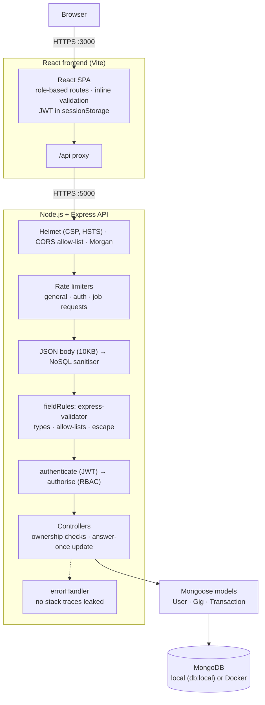

### Job request flow

A client sends a request with their own offer; only the freelancer who received it can accept or decline it, and only once.

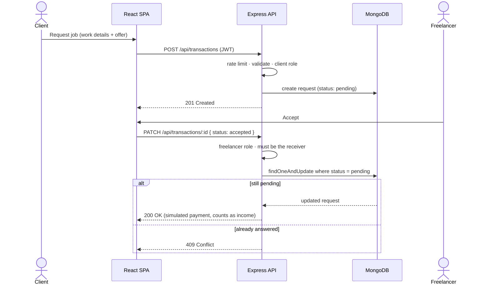

### Data model

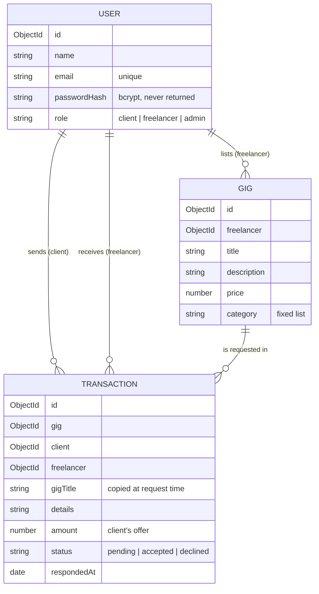

**Request lifecycle (API):**

```
Request → Helmet (headers + CSP) → CORS (origin allow-list) → Rate limiter
  → JSON body (10KB max) → NoSQL sanitiser (strips $ / . keys)
  → Route → [job-request limiter] → authenticate (JWT) → authorise (role)
  → fieldRules / express-validator (validate + escape) → validate (422 on failure)
  → Controller (ownership checks) → Mongoose → MongoDB
  → Response / errorHandler (no stack traces or internals leaked)
```

---

## Project Structure

```
INSY7314/
├── backend/                         # Express API
│   ├── server.js                    # HTTPS entry point – connects to MongoDB, then listens
│   ├── generate-certs.js            # Self-signed SSL certificate generator
│   ├── scripts/
│   │   ├── local-db.js              # npm run db:local – local MongoDB without installing it
│   │   ├── create-admin.js          # npm run create-admin – provisions the admin account
│   │   └── run-newman.js            # npm run test:api – runs the Postman collection with Newman
│   ├── src/
│   │   ├── app.js                   # Middleware stack and route mounting
│   │   ├── config/                  # constants.js (roles, JWT, password policy), db.js (Mongoose)
│   │   ├── models/                  # User, Gig, Transaction (+ safe toJSON transform)
│   │   ├── controllers/             # auth, user, gig, transaction
│   │   ├── middleware/              # auth (JWT + RBAC), fieldRules (shared input rules), validate,
│   │   │                            # sanitize, rateLimiter, errorHandler
│   │   ├── routes/                  # Route definitions + validation chains
│   │   └── utils/logger.js          # Console + file logger (no secrets logged)
│   ├── eslint.config.js             # ESLint 9 flat config (npm run lint)
│   └── tests/                       # Jest + Supertest (in-memory MongoDB)
│
├── frontend/                        # React SPA (Vite)
│   ├── vite.config.js               # HTTPS dev server, /api proxy, CSP + security headers
│   ├── src/
│   │   ├── api/                     # fetch wrapper (safe error handling) + endpoint functions
│   │   ├── auth/AuthContext.jsx     # Session (JWT + user) in sessionStorage, auto-logout on 401
│   │   ├── components/              # NavBar, ProtectedRoute, GigCard, GigForm, FormField, Alert
│   │   ├── pages/                   # Login, Register, Gigs, MyGigs, Bookings, Admin
│   │   ├── utils/                   # Client-side validation, display formatting
│   │   └── test/                    # Vitest + React Testing Library tests
│   └── test-results/                # Frontend test evidence
│
├── hustlehub_api.postman_collection.json   # Postman collection (63 requests)
├── postman/
│   ├── hustlehub-local.postman_environment.json
│   └── newman-results/              # Newman execution evidence
├── images/
│   ├── app/                         # Screenshots of the running application
│   ├── Postman Part1/               # Part 1 Postman evidence
│   └── Postman Part2/               # Part 2: one screenshot per request (63)
├── docker-compose.yml               # API + MongoDB containers
├── ATTRIBUTIONS.md                  # Every reference, image credit, library and tool
└── CHANGELOG.md                     # Part 2 change log
```

---

## Roles & Access Control (RBAC)

Access control is enforced on the server at three levels:

1. **Authentication.** The `authenticate` middleware verifies the JWT's signature, expiry, algorithm, issuer and audience. If any check fails, the request gets **401**.
2. **Authorisation.** `authorise(...roles)` checks the user's role against the roles allowed for the endpoint. A mismatch gets **403**.
3. **Ownership.** Controllers compare the resource's owner with the token's user id. For example, `gig.freelancer` must equal `req.user.id`, otherwise the request gets **403**. Every request and income query is filtered by the logged-in user's id, so users only ever see their own records. Only the freelancer a job request was sent to may accept or decline it (`transaction.freelancer` must equal `req.user.id`).

| Capability | Client | Freelancer | Admin |
|---|:---:|:---:|:---:|
| Browse / view gigs | ✅ | ✅ | ✅ |
| Create gig | ❌ | ✅ | ❌ |
| Update gig | ❌ | ✅ own only | ❌ |
| Delete gig | ❌ | ✅ own only | ✅ any |
| Send job request (details + offer) | ✅ | ❌ | ❌ |
| Accept / decline a job request | ❌ | ✅ own only | ❌ |
| View own requests | ✅ sent | ✅ received | ❌ |
| View income & estimated tax | ❌ | ✅ own only | ❌ |
| List all users | ❌ | ❌ | ✅ |
| List all transactions | ❌ | ❌ | ✅ |

The frontend mirrors these rules, using `ProtectedRoute` and showing only the buttons each role can use. That is purely for usability: the API enforces every rule independently.

---

## API Endpoints

| Method | Endpoint | Access | Description |
|---|---|---|---|
| GET | `/api/health` | Public | Health check |
| POST | `/api/auth/register` | Public (rate limited) | Register a client or freelancer |
| POST | `/api/auth/login` | Public (rate limited) | Log in, receive JWT |
| GET | `/api/users/profile` | Any authenticated | Own profile |
| GET | `/api/users` | Admin | All users |
| GET | `/api/gigs` | Any authenticated | All gigs (freelancer name included) |
| GET | `/api/gigs/mine` | Freelancer | Own gigs |
| GET | `/api/gigs/:id` | Any authenticated | Single gig |
| POST | `/api/gigs` | Freelancer | Create gig |
| PUT | `/api/gigs/:id` | Freelancer (owner) | Update gig (partial) |
| DELETE | `/api/gigs/:id` | Freelancer (owner) or Admin | Delete gig |
| POST | `/api/transactions` | Client (rate limited) | Send a job request (`pending`) |
| PATCH | `/api/transactions/:id` | Freelancer (receiver only) | Accept (simulated payment) or decline a pending request |
| GET | `/api/transactions/mine` | Client / Freelancer | Requests sent (client) or received (freelancer) |
| GET | `/api/transactions/income` | Freelancer | Income from accepted requests + estimated tax |
| GET | `/api/transactions` | Admin | All transactions |

**Send a job request:** `POST /api/transactions` (client)

```json
{ "gigId": "6acd121a18de1397e2432b42", "details": "Logo for a new coffee cart in Durban. Bold, friendly, must work as a small sticker.", "amount": 1500 }
```

The request is stored as `pending` with the client's offer. The freelancer and the gig title always come from the stored gig, so a client cannot redirect a request to someone else or set its status.

**Accept or decline:** `PATCH /api/transactions/:id` with body `{ "status": "accepted" }` or `{ "status": "declined" }` (only the freelancer who received the request)

```json
{
  "message": "Request accepted. Payment simulated successfully.",
  "transaction": {
    "id": "6acd12b618de1397e2432b4f",
    "gigTitle": "Premium Logo Design",
    "details": "Logo for a new coffee cart in Durban. Bold, friendly, must work as a small sticker.",
    "amount": 1500,
    "status": "accepted",
    "respondedAt": "2026-10-12T17:05:13.415Z"
  }
}
```

The update is conditional (`findOneAndUpdate` on `{ _id, status: 'pending' }`), so a request can only ever be answered once, even if two responses arrive together (Mongoose, n.d.). A second attempt returns **409**. The gig title is copied onto the request, so the record stays accurate if the gig is later edited or deleted.

---

## Security Measures

### Summary

| Threat | Control | Where |
|---|---|---|
| Credential theft in transit (MITM) | HTTPS-only API (TLS, RSA 2048 / SHA-256) and HSTS (1 year). The frontend dev server and preview also run over HTTPS. | `server.js`, `app.js`, `vite.config.js` |
| Password cracking after a breach | bcrypt with cost 12. `passwordHash` is `select: false` and stripped by `toJSON`. | `authController.js`, `models/User.js` |
| User enumeration | Same error for unknown email and wrong password, plus timing normalisation with a **real** bcrypt dummy hash (adnan kamili, 2016; Daniel Gartmann, 2016; OWASP Foundation, n.d.a) | `authController.js` |
| Token forgery / misuse | JWT pinned to HS256 and checked for **issuer and audience**, 1-hour expiry, secret loaded from env (Auth0, n.d.) | `middleware/auth.js` |
| Privilege escalation | `authorise()` role checks, ownership checks in controllers (gig owner, request receiver), admin role cannot be self-registered | routes, controllers |
| Insecure direct object reference (IDOR) | Queries filtered by `req.user.id`, and ownership compared before any update or delete | `gigController.js`, `transactionController.js` |
| Mass assignment | Controllers copy only whitelisted fields, so `freelancer`, `role` and `status` cannot be set by the client. A client's offer (`amount`) is validated, never trusted blindly. | controllers |
| NoSQL injection | Sanitiser strips `$` and `.` keys from body, query and params (daniel, 2012). `strictQuery` is on. Ids are validated with `isMongoId()`. | `middleware/sanitize.js`, `config/db.js` |
| Stored XSS | Names and gig titles use a character allow-list (no `<` or `>`). Free text is `.escape()`d. React renders text, never HTML (no `dangerouslySetInnerHTML`) (user1210233, 2015). Strict CSP. | `fieldRules.js`, routes, frontend |
| Malformed / unexpected input | Type checks (arrays or objects where text is expected are rejected), control characters rejected, money limited to 2 decimal places, fixed category list, email capped at 254 characters (OWASP Foundation, n.d.b) | `middleware/fieldRules.js` |
| Brute force / credential stuffing | Auth limiter: 20 requests per 15 minutes per IP | `middleware/rateLimiter.js` |
| Job-request spam | Request limiter: 10 requests per 15 minutes per IP | `middleware/rateLimiter.js` |
| General abuse / DoS | 100 requests per 15 minutes on `/api/*`, 10KB body limit, 128-character password cap (prevents bcrypt DoS) | `app.js`, `authRoutes.js` |
| Clickjacking, MIME sniffing | Helmet: `frame-ancestors 'none'`, `X-Frame-Options`, `nosniff` (Helmet.js, n.d.). The frontend sends the same headers. | `app.js`, `vite.config.js` |
| Cross-origin abuse | CORS allow-list (`CORS_ORIGIN`). Unknown origins get **403**. | `app.js` |
| Information disclosure | Global error handler: no stack traces or internals. The frontend shows a generic message on 5xx errors. No source maps in the build. | `errorHandler.js`, `api/client.js`, `vite.config.js` |

### Validation & sanitisation

All input is validated with `express-validator` chains **before** it reaches a controller. The rules are shared from one module, `backend/src/middleware/fieldRules.js`, so the same field is checked the same way on every route (express-validator, n.d.; Micah Bala, 2019). Allow-lists are used wherever the set of valid characters is known, as OWASP recommends (OWASP Foundation, n.d.b). Invalid input returns **422** with a `fields` array, which the frontend displays next to the matching form fields:

| Endpoint | Rules |
|---|---|
| Register | Name 2–80 characters, letters, spaces, apostrophes, hyphens and full stops only, matched with Unicode letter classes (maerics, 2011; MDN contributors, 2026f) (e.g. `Zoë O'Brien-Nkosi`). Valid email, at most 254 characters (normalised). Password 8–128 characters with upper, lower, number and special characters. Role must be `client` or `freelancer`. |
| Login | Valid email. Password required (must be text), maximum 128 characters. |
| Create / update gig | Title 5–100 characters from a character allow-list and must contain a letter. Description 10–2000 characters (line breaks allowed, escaped). Price 1–1,000,000 with at most 2 decimal places. Category must be one of the fixed list (Design, Writing, Development, Marketing, Finance, Admin Support, Video & Animation, Photography, Tutoring, Other). On update every field is optional, but any field sent is validated. |
| Send job request | `gigId` a valid ObjectId. Work details 10–2000 characters (escaped). Offer 1–1,000,000 with at most 2 decimal places (Alexander, 2020). |
| Accept / decline | `:id` a valid ObjectId. `status` must be exactly `accepted` or `declined`. |
| Every text field | Must be a string (arrays and objects are rejected). Control characters are rejected; only multi-line fields may contain line breaks (user606521, 2014). |
| `:id` params | `isMongoId()` |

The frontend runs the same checks (`src/utils/validation.js`) for instant feedback, and the gig category is a dropdown, but the server never relies on any of it.

Text is stored HTML-escaped (for example, `<script>` is stored as `&lt;script&gt;`). The frontend decodes these entities for display (`decodeEntities`). This is safe because React inserts strings as text nodes: a payload is shown literally and never executed (user1210233, 2015). The tests cover this case.

### Rate limiting

| Limiter | Applies to | Limit | Response when exceeded |
|---|---|---|---|
| General | `/api/*` | 100 requests per 15 minutes per IP (configurable via `RATE_LIMIT_*`) | `429 { "error": "Too many requests from this IP. Please try again later.", "retryAfterSeconds": 900 }` |
| Auth | `/api/auth/*` | 20 requests per 15 minutes per IP | `429 { "error": "Too many authentication attempts. Please try again in 15 minutes.", ... }` |
| Job request | `POST /api/transactions` | 10 requests per 15 minutes per IP | `429 { "error": "Too many booking attempts. Please try again in 15 minutes.", ... }` |

All limiters also send the standard `RateLimit-*` and `Retry-After` headers, and return the message as JSON so the frontend can show it (xyz83242, 2019).

### Security headers & Content Security Policy

**API (Helmet):**
```
Content-Security-Policy: default-src 'self'; script-src 'self'; style-src 'self'; img-src 'self' data:;
                         object-src 'none'; frame-ancestors 'none'; base-uri 'self'; form-action 'self'
Strict-Transport-Security: max-age=31536000; includeSubDomains; preload
X-Content-Type-Options: nosniff · X-Frame-Options: SAMEORIGIN · Referrer-Policy: no-referrer · (X-Powered-By removed)
```

**Frontend (production build via `npm run preview`):**
```
Content-Security-Policy: default-src 'self'; script-src 'self'; style-src 'self'; img-src 'self' data:; font-src 'self';
                         connect-src 'self'; object-src 'none'; base-uri 'self'; form-action 'self'; frame-ancestors 'none'
X-Frame-Options: DENY · X-Content-Type-Options: nosniff · Referrer-Policy: strict-origin-when-cross-origin
Permissions-Policy: camera=(), microphone=(), geolocation=()
```

The built app contains no inline scripts or styles, so the CSP doesn't need `'unsafe-inline'`. `connect-src 'self'` works because the browser only ever calls its own origin (`/api` is proxied to the backend). The CSP is not sent by the dev server (`npm run dev`), because Vite's hot reload injects inline scripts. The other security headers are still sent.

### Frontend session handling

- The JWT and the safe user object are stored in **sessionStorage**, not localStorage, so they're cleared when the tab closes (MDN contributors, 2025; Timespace, 2014). No password is ever stored.
- Expired tokens are discarded on load. Any **401** from the API logs the user out with a "session expired" message.
- Rejected passwords are cleared from the login form.

### Password hashing & timing-attack defence

bcrypt (cost 12) is slow by design. It salts every hash, defeating rainbow tables, and resists GPU cracking. If a login used an unknown email and the server skipped bcrypt, that request would return faster than one with a known email, revealing which emails are registered. HustleHub+ therefore always runs `bcrypt.compare`, using a dummy hash when no user is found (adnan kamili, 2016).

> **Part 2 fix:** Part 1's dummy hash was not a valid 60-character bcrypt string, so bcrypt rejected it instantly (~1ms versus ~390ms) and the defence did not work. It is now a real hash generated at startup with the same cost factor:
> ```javascript
> const DUMMY_HASH = bcrypt.hashSync('timing-normalisation-dummy', SALT_ROUNDS);
> ```

### JWT

The token payload contains only `id`, `email`, `role`, `iat`, `exp`, `iss` and `aud`. Verification checks all of them (Auth0, n.d.):

```javascript
jwt.verify(token, process.env.JWT_SECRET, {
  algorithms: ['HS256'],          // blocks alg:none / algorithm confusion
  issuer:     'hustlehub-api',    // Part 2: now enforced
  audience:   'hustlehub-client', // Part 2: now enforced
});
```

---

## Getting Started

### Prerequisites

- Node.js 18 or later (tested on 22) and npm 9 or later
- MongoDB. Use **one** of these:
  - An existing MongoDB server on `mongodb://127.0.0.1:27017`, **or**
  - `npm run db:local`, which downloads and runs MongoDB for you. Nothing needs to be installed.

### Installation

```bash
git clone https://github.com/ST10445928/INSY7314.git
cd INSY7314

# Backend
cd backend
npm install
cp .env.example .env
node generate-certs.js        # creates ssl/server.key + ssl/server.cert (used by both apps)

# Frontend
cd ../frontend
npm install
```

### Backend environment (`backend/.env`)

```env
PORT=5000
NODE_ENV=development
MONGO_URI=mongodb://127.0.0.1:27017/hustlehub
JWT_SECRET=<64+ random chars: node -e "console.log(require('crypto').randomBytes(64).toString('hex'))">
JWT_EXPIRES_IN=1h
SSL_KEY_PATH=./ssl/server.key
SSL_CERT_PATH=./ssl/server.cert
CORS_ORIGIN=https://localhost:3000        # comma-separate to allow several origins
RATE_LIMIT_WINDOW_MS=900000
RATE_LIMIT_MAX_REQUESTS=100
BCRYPT_SALT_ROUNDS=12
ADMIN_NAME=Platform Admin
ADMIN_EMAIL=admin@hustlehub.test
ADMIN_PASSWORD=<strong password for the admin account>
```

> ⚠️ `.env` is git-ignored. Never commit it.

---

## Running the Backend

```bash
cd backend

# 1. Start MongoDB (skip if you already run MongoDB on port 27017)
npm run db:local          # leave this terminal open; data is kept in backend/.mongo-data
                          # if 27017 is taken: LOCAL_DB_PORT=27018 npm run db:local
                          # and set MONGO_URI=mongodb://127.0.0.1:27018/hustlehub

# 2. Create the admin account (once; uses ADMIN_* from .env)
npm run create-admin

# 3. Start the API
npm run dev               # auto-restart on changes
# or: npm start
```

The API runs at **https://localhost:5000**. The certificate is self-signed, so Postman needs SSL verification turned off.

## Running the Frontend

```bash
cd frontend
npm run dev               # https://localhost:3000 (hot reload)

# Production build with full CSP headers:
npm run build
npm run preview           # https://localhost:3000
```

Open **https://localhost:3000** and accept the self-signed certificate warning once. The frontend proxies `/api` to `https://localhost:5000`, so the backend must be running. To use another API address, set `VITE_API_TARGET`.

**Try the full flow:**
1. Register as a **freelancer**, then create a gig under **My gigs**.
2. Log out, register as a **client**, then **Browse gigs**, choose **Request job**, describe the work, set your offer and **Send request**.
3. Check **My requests** as the client (status `pending`). Log back in as the freelancer, open **Requests & income** and **Accept** (or **Decline**) the request. Income and estimated tax update straight away.
4. Log in as the **admin** (from `create-admin`) to see all users and transactions.

---

## Running with Docker

```bash
cd backend && node generate-certs.js && cd ..
JWT_SECRET=<64+ random chars> docker compose up --build
```

`docker-compose.yml` starts MongoDB (not exposed to the host) and the API on **https://localhost:5000**. The API waits until MongoDB is healthy. The image runs as a non-root user, and certificates are mounted read-only, never baked into the image.

---

## Testing Procedures

| Suite | Tool | Command | Result |
|---|---|---|---|
| Backend unit/integration | Jest + Supertest + in-memory MongoDB | `cd backend && npm test` | **103 passing** (4 suites) |
| Frontend components | Vitest + React Testing Library + user-event | `cd frontend && npm test` | **34 passing** (7 files) |
| API (end-to-end) | Postman collection + Newman | `cd backend && npm run test:api` | **63 requests, 126 assertions, 0 failures** |
| Lint | ESLint (backend), oxlint (frontend) | `npm run lint` in each app | no errors |

**Continuous integration** (`.github/workflows/ci.yml`) runs on every push and pull request. It lints and tests the backend, lints, tests and builds the frontend, runs `npm audit` (fails on high or critical) and builds the Docker image.

### Backend tests (`backend/tests/`)

Each test file starts its own in-memory MongoDB (`mongodb-memory-server`, downloaded automatically on the first run), and collections are cleared after every test.

| File | What it covers |
|---|---|
| `auth.test.js` | Registration and login, success and failure cases, password policy, protected profile route, malformed tokens |
| `gigs.test.js` | Gig CRUD. Another freelancer **cannot** edit or delete a gig (403). Clients cannot manage gigs. Admin delete. Update validation. Ownership can't be reassigned. HTML in a title is rejected; HTML in a description is escaped. **Input hardening:** arrays, control characters, symbol-only titles, 3-decimal or exponent prices and categories outside the list are all rejected with 422. |
| `transactions.test.js` | A job request is created as `pending` with the client's details and offer. The client can't redirect it to another freelancer or set its status. Only the receiving freelancer can accept or decline it, and only once (409 on a second answer). Only accepted requests count as income. Clients and freelancers only see their own requests. Admin views, plus 401, 403, 404 and 422 cases. |
| `security.test.js` | NoSQL injection, JWT audience, signature and expiry checks, admin-only routes, admin role can't be self-registered, 128-character password cap, **429 responses from the request and auth limiters**, Helmet/CSP headers, CORS rejection, and input hardening for accounts and requests (wrong types never cause a 500). |

### Frontend tests (`frontend/src/test/`)

| File | What it covers |
|---|---|
| `LoginPage.test.jsx` | Renders the form. Inline validation stops empty submits. A successful login calls the API and redirects. A 401 shows a generic message and clears the password. **A 500 never shows raw server details.** |
| `RegisterPage.test.jsx` | Weak passwords and mismatched passwords are caught before any API call. A freelancer registration sends the right role and redirects. A duplicate-email error is shown. |
| `GigsPage.test.jsx` | Clients see Request job buttons and freelancers don't. A client sends a request with work details and their own offer. Invalid details or offers are caught inline and nothing is sent. Cancelling sends nothing. A 429 is shown to the user. **XSS payloads render as text, never as markup.** |
| `BookingsPage.test.jsx` | A freelancer accepts a pending request, and the list and income reload. An already-answered request shows the API's 409 message. Clients see status but get no accept or decline buttons. |
| `GigForm.test.jsx` | Field validation, trimmed numeric submission, the category is a fixed dropdown (free text can't be entered), edit mode pre-filled with decoded text, server field errors |
| `ProtectedRoute.test.jsx` | Logged-out users go to /login. Wrong roles go to /gigs. Expired tokens count as logged out. |
| `utils.test.js` | Password policy matches the API. Role allow-list. Price range and 2-decimal rule. Name, title and category allow-lists. Control characters. Request details and offer. Entity decoding. Currency formatting. |

**Evidence:** `npm run test:report` writes [`frontend/test-results/vitest-output.txt`](frontend/test-results/vitest-output.txt) and [`frontend/test-results/junit.xml`](frontend/test-results/junit.xml).

### Postman collection & Newman

[`hustlehub_api.postman_collection.json`](hustlehub_api.postman_collection.json) contains **63 requests in 7 folders**. Each request has test scripts that check status codes, response shape and security properties: no `passwordHash` or stack traces leaked, escaped HTML, correct ownership.

| Folder | Success cases | Failure cases |
|---|---|---|
| 1. Health & Security Headers | Health 200 | CSP, HSTS, nosniff and X-Powered-By assertions |
| 2. Authentication | Register freelancer ×2 and client, login client and admin | Duplicate 409, weak password 422, bad email 422, invalid name characters 422, admin role 422, NoSQL injection 422, wrong password 401, unknown email 401 |
| 3. Protected Routes | Profile with token | No token 401, tampered token 401 |
| 4. Gigs | Create, list, get, my gigs, update by owner | Client create 403, invalid input 422, XSS in description escaped, HTML in title 422, category not in list 422, no token 401, invalid id 422, client my-gigs 403, other freelancer update 403, invalid update 422 |
| 5. Job Requests & Transactions | Send request (pending, client's offer), client/freelancer my requests, owner accepts (simulated payment), income after acceptance | Missing details 422, invalid amount 422, freelancer send 403, no token 401, missing gig 404, invalid gig id 422, other freelancer sees none, pending not counted as income, client/admin/other freelancer respond 403, invalid status 422, invalid id 422, second answer 409, client income 403 |
| 6. Admin | List users, all transactions, delete any gig | Client users 403, freelancer transactions 403 |
| 7. Gig Deletion | Owner delete, accepted request kept after the gig is deleted | Other freelancer 403, client 403, deleted gig 404 |

**Run with Newman** (API running, admin created):

```bash
cd backend
npm run test:api
```

The runner (`scripts/run-newman.js`) passes the admin password from `.env` with `--env-var`, so it never appears in the committed environment file. Each run registers new users with a timestamp, so the collection can be re-run against the same database. A full run makes 13 requests to the auth endpoints, though, so restart the API (or wait 15 minutes) before running it again.

**Evidence:** [`postman/newman-results/newman-cli-output.txt`](postman/newman-results/newman-cli-output.txt) (full CLI run) and [`postman/newman-results/newman-report.xml`](postman/newman-results/newman-report.xml) (JUnit).

```
┌─────────────────────────┬───────────────────┬───────────────────┐
│                         │          executed │            failed │
├─────────────────────────┼───────────────────┼───────────────────┤
│                requests │                63 │                 0 │
│            test-scripts │                63 │                 0 │
│              assertions │               126 │                 0 │
└─────────────────────────┴───────────────────┴───────────────────┘
```

To use the collection in Postman: import the collection and `postman/hustlehub-local.postman_environment.json`, set `adminPassword` in the environment, turn off SSL certificate verification (or use the Postman Desktop Agent with Postman on the web), then run the requests in order.

**Per-request evidence:** [`images/Postman Part2/`](images/Postman%20Part2/) has one screenshot for each of the 63 requests, numbered in run order (e.g. `50-accept-request-owner-200.jpg`). Each shows the request, the status code, the response body and the passing test count.

---

## Application Screenshots

| | |
|---|---|
| **Login** 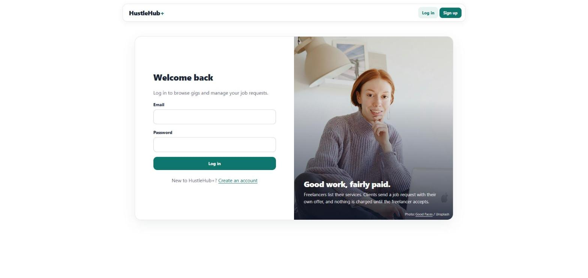 | **Inline validation on register** 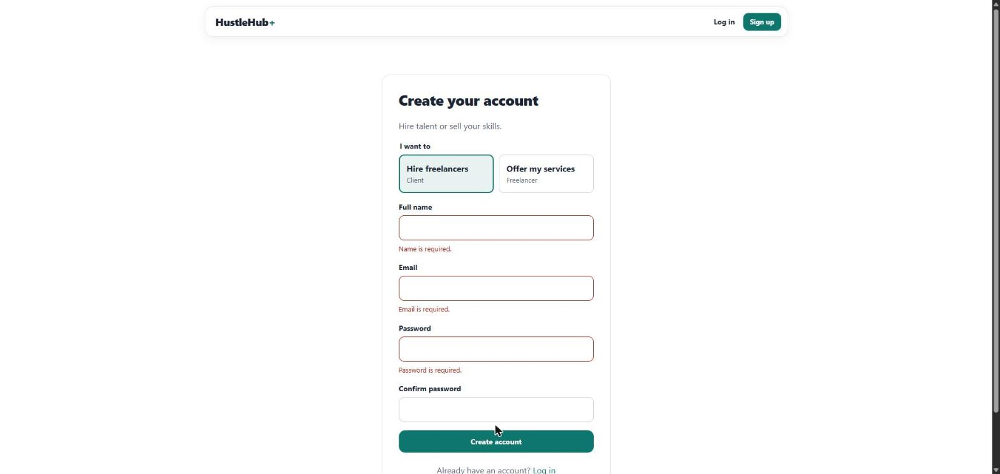 |
| **Browse gigs (client)** 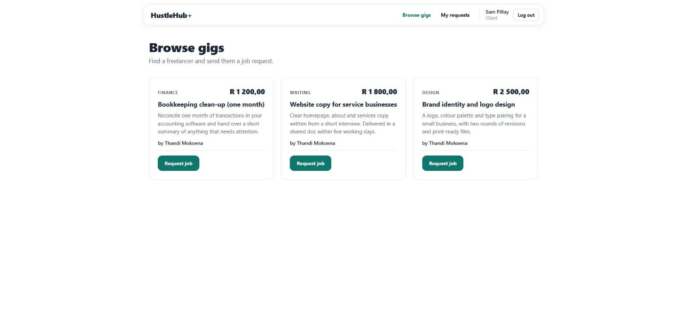 | **Job request form** 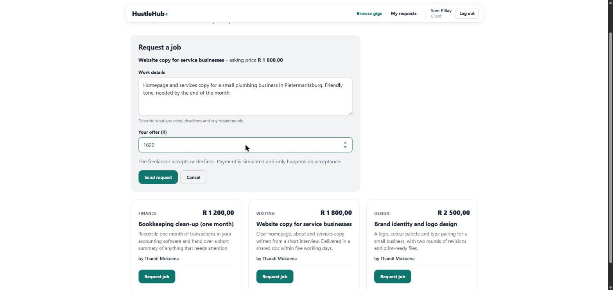 |
| **Request sent** 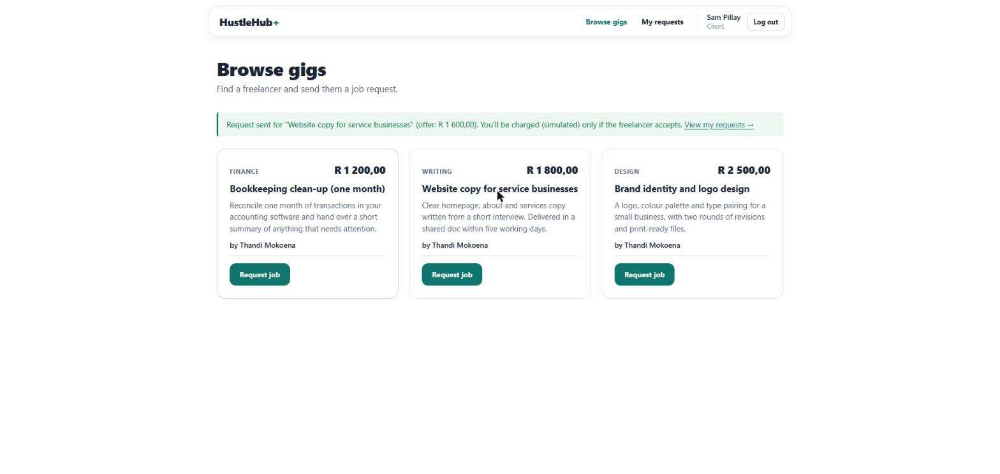 | **My requests (client)** 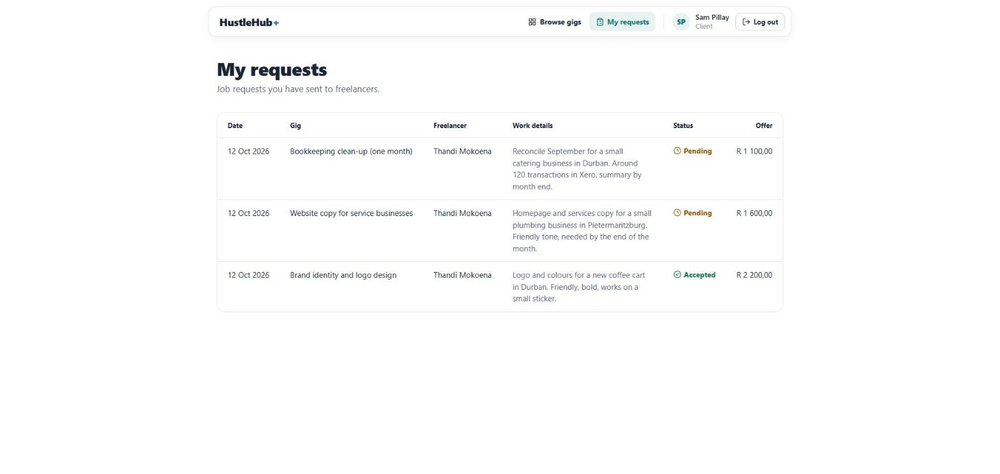 |
| **Requests & income – accept/decline (freelancer)** 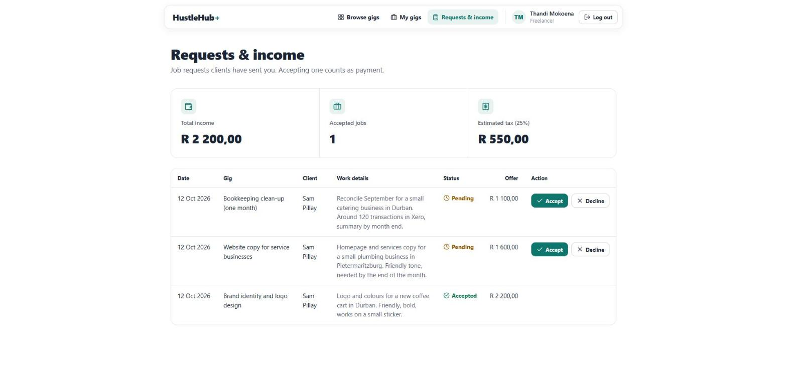 | **My gigs (freelancer)** 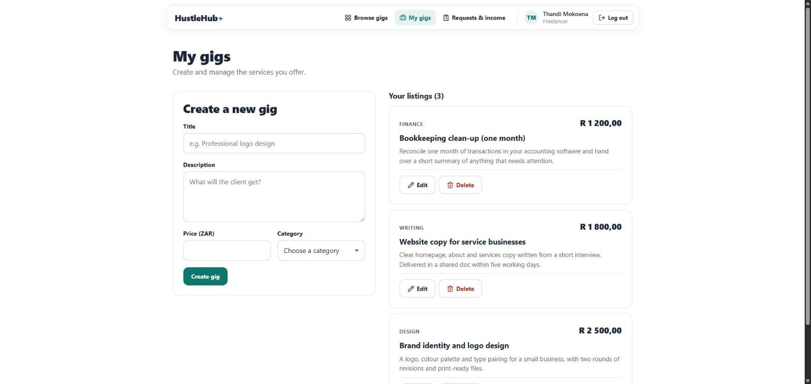 |
| **Admin – users** 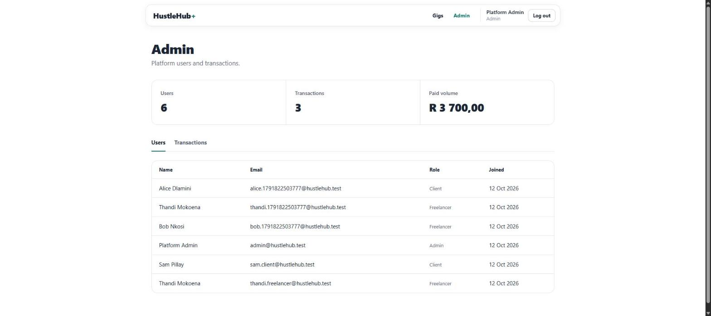 | **Admin – transactions** 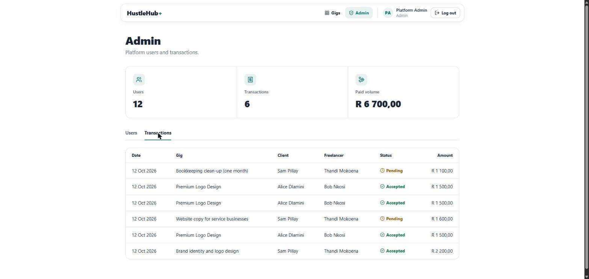 |

---

## Demonstration Video

> _Add the Part 2 demonstration video link here. It should show authentication, gig creation, a client sending a job request, the freelancer accepting it, and the transaction and income being recorded._

Part 1 video: [https://youtu.be/tYWpZ3LTc-E](https://youtu.be/tYWpZ3LTc-E)

---

## Part 1 Evidence

Part 1 (Secure Backend Foundations) Postman screenshots are kept in [`images/Postman Part1/`](images/Postman%20Part1/) (`postman1.png` – `postman15.png`). They cover the health check, registration and validation, login, protected routes and the RBAC gig checks from the original JSON-file-backed API.

---

## References

References are cited in the text above in Harvard style (Author, Year), and also appear as comments next to the code they informed. The complete list, including image credits, design inspiration and every library and tool with its licence, is in [`ATTRIBUTIONS.md`](ATTRIBUTIONS.md).

| Source | Used in |
|---|---|
| adnan kamili (2016) *Is bcrypt.compare vulnerable to timing attack*. Stack Overflow. https://stackoverflow.com/questions/35620979/is-bcrypt-compare-vulnerable-to-timing-attack (Accessed: 11 October 2026) | `authController.js` (dummy hash) |
| Daniel Gartmann (2016) *How to prevent user enumeration attacks for a login system?* Stack Overflow. https://stackoverflow.com/questions/35827127/how-to-prevent-user-enumeration-attacks-for-a-login-system (Accessed: 11 October 2026) | `authController.js` (login) |
| OWASP Foundation (n.d.a) *Authentication Cheat Sheet*. OWASP Cheat Sheet Series. https://cheatsheetseries.owasp.org/cheatsheets/Authentication_Cheat_Sheet.html (Accessed: 11 October 2026) | `authController.js` (login) |
| Auth0 (n.d.) *node-jsonwebtoken: JsonWebToken implementation for node.js*. GitHub. https://github.com/auth0/node-jsonwebtoken (Accessed: 11 October 2026) | `middleware/auth.js` |
| daniel (2012) *JavaScript NoSQL Injection prevention in MongoDB*. Stack Overflow. https://stackoverflow.com/questions/13436467/javascript-nosql-injection-prevention-in-mongodb (Accessed: 11 October 2026) | `middleware/sanitize.js` |
| Micah Bala (2019) *How to implement validation in a separate file using express-validator*. Stack Overflow. https://stackoverflow.com/questions/55772477/how-to-implement-validation-in-a-separate-file-using-express-validator (Accessed: 11 October 2026) | `middleware/fieldRules.js` |
| express-validator (n.d.) *The Validation Chain*. express-validator Documentation. https://express-validator.github.io/docs/guides/validation-chain (Accessed: 11 October 2026) | `middleware/fieldRules.js` |
| OWASP Foundation (n.d.b) *Input Validation Cheat Sheet*. OWASP Cheat Sheet Series. https://cheatsheetseries.owasp.org/cheatsheets/Input_Validation_Cheat_Sheet.html (Accessed: 11 October 2026) | `middleware/fieldRules.js` |
| user606521 (2014) *How to remove control characters from string?* Stack Overflow. https://stackoverflow.com/questions/26741455/how-to-remove-control-characters-from-string (Accessed: 11 October 2026) | `middleware/fieldRules.js` |
| maerics (2011) *Matching a Unicode "name" with a JavaScript Regular Expression*. Stack Overflow. https://stackoverflow.com/questions/5571096/matching-a-unicode-name-with-a-javascript-regular-expression (Accessed: 11 October 2026) | `middleware/fieldRules.js` |
| MDN contributors (2026f) *Unicode character class escape: \p{...}, \P{...}*. MDN Web Docs. https://developer.mozilla.org/en-US/docs/Web/JavaScript/Reference/Regular_expressions/Unicode_character_class_escape (Accessed: 11 October 2026) | `middleware/fieldRules.js` |
| Alexander (2020) *Validate input is within a numeric range, possibly a float, using express-validator*. Stack Overflow. https://stackoverflow.com/questions/63404065/validate-input-is-within-a-numeric-range-possibly-a-float-using-express-valida (Accessed: 11 October 2026) | `middleware/fieldRules.js` (money) |
| xyz83242 (2019) *express-rate-limit - catching the message*. Stack Overflow. https://stackoverflow.com/questions/58486616/express-rate-limit-catching-the-message (Accessed: 11 October 2026) | `middleware/rateLimiter.js` |
| Helmet.js (n.d.) *Helmet.js*. Helmet Documentation. https://helmetjs.github.io/ (Accessed: 11 October 2026) | `app.js` |
| Mongoose (n.d.) *How to Use findOneAndUpdate() in Mongoose*. Mongoose Documentation. https://mongoosejs.com/docs/tutorials/findoneandupdate.html (Accessed: 11 October 2026) | `transactionController.js` (accept/decline once) |
| Timespace (2014) *Where to store JWT in browser? How to protect against CSRF?* Stack Overflow. https://stackoverflow.com/questions/27067251/where-to-store-jwt-in-browser-how-to-protect-against-csrf (Accessed: 11 October 2026) | `frontend/src/auth/AuthContext.jsx` |
| MDN contributors (2025) *Window: sessionStorage property*. MDN Web Docs. https://developer.mozilla.org/en-US/docs/Web/API/Window/sessionStorage (Accessed: 11 October 2026) | `frontend/src/auth/AuthContext.jsx` |
| user1210233 (2015) *What does it mean when they say React is XSS protected?* Stack Overflow. https://stackoverflow.com/questions/33644499/what-does-it-mean-when-they-say-react-is-xss-protected (Accessed: 11 October 2026) | `frontend/src/utils/format.js` |
| Lucide Contributors (n.d.) *Lucide for React*. Lucide Documentation. https://lucide.dev/guide/react (Accessed: 11 October 2026) | Icons throughout the UI (`NavBar.jsx`, `GigCard.jsx`, `StatusLabel.jsx`, pages) |
| React Router (n.d.) *NavLink*. React Router Documentation. https://reactrouter.com/api/components/NavLink (Accessed: 11 October 2026) | `NavBar.jsx` (active page highlight) |
| MDN contributors (2026e) *<select>: The HTML Select element*. MDN Web Docs. https://developer.mozilla.org/en-US/docs/Web/HTML/Reference/Elements/select (Accessed: 11 October 2026) | `GigForm.jsx` (category dropdown) |
| MDN contributors (2026b) *: The Image Embed element*. MDN Web Docs. https://developer.mozilla.org/en-US/docs/Web/HTML/Reference/Elements/img (Accessed: 11 October 2026) | `Photo.jsx` |
| MDN contributors (2026c) *object-fit*. MDN Web Docs. https://developer.mozilla.org/en-US/docs/Web/CSS/Reference/Properties/object-fit (Accessed: 11 October 2026) | `Photo.jsx`, `index.css` |
| MDN contributors (2026a) *Basic concepts of grid layout*. MDN Web Docs. https://developer.mozilla.org/en-US/docs/Web/CSS/Guides/Grid_layout/Basic_concepts (Accessed: 11 October 2026) | `index.css` (split login/register layout, grids) |
| MDN contributors (2026d) *prefers-reduced-motion*. MDN Web Docs. https://developer.mozilla.org/en-US/docs/Web/CSS/Reference/At-rules/@media/prefers-reduced-motion (Accessed: 11 October 2026) | `index.css` |
| Unsplash (n.d.) *License*. Unsplash. https://unsplash.com/license (Accessed: 11 October 2026) | `assets/photos.js` |
| Toa Heftiba (2018) *Cup of coffee, laptop computer, and red earphones plugged in laptop on brown wooden table* [Photograph]. Unsplash. https://unsplash.com/photos/cup-of-coffee-laptop-computer-and-red-earphones-plugged-in-laptop-on-brown-wooden-table-W6q15ddqqJo (Accessed: 11 October 2026) | Browse gigs banner (`public/images/hero-workspace.jpg`) |
| Good Faces (2021) *Woman in gray sweater sitting on chair using macbook* [Photograph]. Unsplash. https://unsplash.com/photos/woman-in-gray-sweater-sitting-on-chair-using-macbook-gy5SlRW9OGA (Accessed: 11 October 2026) | Log in page (`public/images/auth-login.jpg`) |
| Daniel Thomas (2020) *Person using black and silver laptop computer* [Photograph]. Unsplash. https://unsplash.com/photos/person-using-black-and-silver-laptop-computer-6_NXEMZbUq0 (Accessed: 11 October 2026) | Register page (`public/images/auth-register.jpg`) |
| Mermaid (n.d.) *About Mermaid*. Mermaid Documentation. https://mermaid.js.org/intro/ (Accessed: 11 October 2026) | Architecture, job request and data model diagrams (README) |
